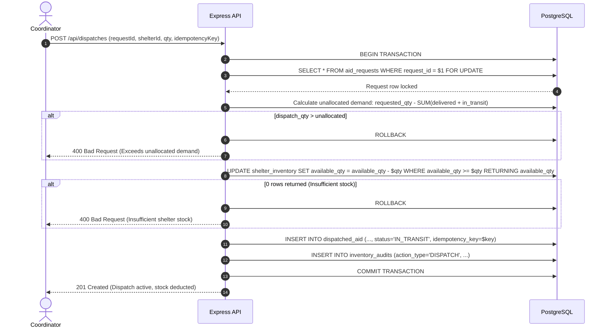

# Community Disaster Relief & Resource Allocation System

[](https://sdgs.un.org/goals/goal11)
[](https://supabase.com)
[](https://expressjs.com)
[](https://vitejs.dev)
[](https://deepmind.google/technologies/gemini/)
[](https://fastapi.tiangolo.com)

A DBMS mini-project aligned with **UN Sustainable Development Goal 11: Sustainable Cities and Communities (Target 11.5: Disaster Risk Reduction and Humanitarian Resilience)**. The application coordinates disaster incidents, affected zones, family registrations, warehouse stocks, transactional dispatches, volunteer missions, AI situational briefings, OpenCV photo evidence validation, and predictive machine learning demand forecasting.

---

## 1. System Architecture

```
                                  +-----------------------------+
                                  |   React + Vite Frontend     |
                                  |   (Role-Based UI & Map)     |
                                  +--------------+--------------+
                                                 | REST APIs & JWT
                                                 v
+------------------------+        +--------------+--------------+        +---------------------------+
|  Google Gemini (AI)    |<-------|   Express.js Application    |------->|   FastAPI Microservice    |
|  Draft Crisis Briefing |        |   API (Port 5000)           |        |   Port 8000 (OpenCV & ML) |
+------------------------+        +--------------+--------------+        +---------------------------+
                                                 | pg / Supabase Client
                                                 v
                                  +--------------+--------------+
                                  |    PostgreSQL on Supabase   |
                                  |    (Normalized 3NF + RLS)   |
                                  +-----------------------------+
```

### Module Directory Structure

```text
dbms_mini/
├── backend/                  # Node.js + Express REST API
│   ├── src/
│   │   ├── config/           # Database pool (PostgreSQL/Supabase + zero-config fallback)
│   │   ├── middleware/       # JWT auth & role authorization guards
│   │   ├── routes/           # REST endpoints (Incidents, Zones, Families, Inventory, Dispatches, AI)
│   │   ├── services/         # Transactional dispatch engine, Gemini client, FastAPI client
│   │   └── index.js          # Express app entry point
│   ├── tests/                # Automated scenario and unit tests
│   └── .env.example
├── frontend/                 # React 18 + Vite dashboard interface
│   ├── src/
│   │   ├── api/client.js     # Centralized HTTP client
│   │   ├── components/       # MapView, BriefingCard, PredictionCard, Modals
│   │   ├── context/          # Supabase AuthContext & Persona Switcher
│   │   └── pages/            # Dashboard, Incidents, Families, Inventory, Dispatches, Volunteers, Reports
│   └── .env.example
├── python-service/           # FastAPI microservice for vision & ML
│   ├── image_processing/     # OpenCV validation, EXIF auto-rotation, thumbnail generation
│   ├── ml/                   # Synthetic dataset generator, chronological training & evaluation
│   ├── main.py               # FastAPI endpoints (/health, /predict, /api/images/process)
│   └── requirements.txt
├── supabase/                 # Database migrations and seed fixtures
│   ├── config.toml           # Supabase CLI configuration
│   ├── migrations/           # 20261122000000_initial_schema.sql (Tables, PK/FK, RLS, Indexes)
│   └── seed.sql              # Scenario test fixtures (Shelter North=80, South=55, Zone A=100)
├── docs/
│   └── API.md                # Comprehensive REST API specifications & payloads
├── tests/
│   └── e2e_scenario_runner.js # End-to-end acceptance check runner
└── README.md
```

---

## 2. Normalized Relational Database Design (3NF)

The schema implements the normalized relational design specified in the project report:

| Relation | Primary Key | Foreign Keys | Normalization & Integrity Highlights |
|---|---|---|---|
| `incidents` | `incident_id` | - | Validates status in `('OPEN', 'ACTIVE', 'UNDER_CONTROL', 'CLOSED', 'MONITORING')` |
| `affected_zones` | `zone_id` | `incident_id` | Geographic coordinates (`latitude`, `longitude`), `UNIQUE(incident_id, zone_name)` |
| `affected_families` | `family_id` | `zone_id` | Household census with `member_count > 0`, `UNIQUE(zone_id, household_ref)`, RLS protected |
| `shelters` | `shelter_id` | - | Warehouse addresses and coordinate markers |
| `relief_supplies` | `supply_id` | - | Standard catalogue with measurement units (e.g., `kits`, `pieces`, `liters`) |
| `shelter_inventory` | `(shelter_id, supply_id)` | `shelter_id`, `supply_id` | Composite PK. Relational constraint: `CHECK (available_qty >= 0)` |
| `aid_requests` | `request_id` | `zone_id`, `supply_id` | Item-level requests with priority triage and `CHECK (requested_qty > 0)` |
| `dispatched_aid` | `dispatch_id` | `request_id`, `shelter_id` | Status in `('IN_TRANSIT', 'DELIVERED', 'CANCELLED')`, `idempotency_key` |
| `volunteers` | `volunteer_id` | - | Skills register and status in `('AVAILABLE', 'BUSY', 'UNAVAILABLE')` |
| `volunteer_assignments` | `(dispatch_id, volunteer_id)` | `dispatch_id`, `volunteer_id` | Composite PK resolving many-to-many relationship |
| `inventory_audits` | `audit_id` | `shelter_id`, `supply_id` | Comprehensive audit ledger of every dispatch, return, and restock |

---

## 3. Safe Transactional Dispatch Algorithm

To eliminate over-allocation, race conditions, and negative inventory, dispatch creation runs in **one atomic database transaction**:



### Idempotency & Safe State Transitions
- **Delivery Confirmation (`POST /api/dispatches/:id/receive`)**: Transitions `IN_TRANSIT` $\rightarrow$ `DELIVERED` and records `received_at`. Safe to retry without double deduction.
- **Verified Return & Cancellation (`POST /api/dispatches/:id/cancel`)**: Transitions `IN_TRANSIT` $\rightarrow$ `CANCELLED` and restores stock to the source shelter in the same transaction. Safe to retry without double restoration.

---

## 4. Benchmark Flood Scenario Acceptance Results

The implementation satisfies the benchmark validation cases:

| Test Case | Scenario Action | Expected Result | Status |
|---|---|---|---|
| **Step 1** | Zone A requests 100 food kits | Request #1 logged with 100 unallocated units | **PASSED** |
| **Step 2** | Shelter North (80 kits) dispatches 60 | North stock falls to 20; Dispatch #1 in transit | **PASSED** |
| **Step 3** | Shelter South (55 kits) dispatches 40 | South stock falls to 15; Dispatch #2 in transit | **PASSED** |
| **Step 4** | Field officer confirms North's receipt | Dashboard shows 60 delivered, 40 in transit, 0 unallocated | **PASSED** |
| **Step 5** | Verify balances | North stock = 20, South stock = 15 | **PASSED** |
| **Step 6** | Cancel South dispatch on verified return | South stock returns to 55; unallocated becomes 40 | **PASSED** |
| **Step 7** | Retry cancellation | South stock stays 55 (Idempotent, no double crediting) | **PASSED** |
| **Step 8** | Insufficient stock (request 25 from 20) | Operation rejected; inventory preserved | **PASSED** |
| **Step 9** | Over-allocation (allocate 50 against 40) | Operation rejected; balances preserved | **PASSED** |
| **Step 10** | Concurrent competition for last units | Mutex / row lock ensures at most one succeeds; stock never negative | **PASSED** |
| **Step 11** | Idempotency key duplicate submission | Second submission deduplicated; returns existing dispatch | **PASSED** |
| **Step 12** | Unauthorized access check | Volunteers/Shelter staff denied family census records (403 Forbidden) | **PASSED** |
| **Step 13** | Request with zero dispatches | Query reports delivered = 0, in_transit = 0, unallocated = requested_qty | **PASSED** |

---

## 5. Local Setup & Execution Guide (Windows PowerShell)

### Prerequisites
- Node.js (v18+) and npm
- Python (v3.10+) with pip
- Git

### Step 1: Install Dependencies

```powershell
# In project root:
cd backend
npm install
cd ../frontend
npm install
cd ..
```

### Step 2: Set Up Python Microservice Virtual Environment

```powershell
cd python-service
python -m venv .venv
.\.venv\Scripts\Activate.ps1
pip install -r requirements.txt

# Train the demand prediction model and evaluate MAE benchmark:
python ml/train_model.py

# Run standalone microservice tests:
python test_service.py
cd ..
```

### Step 3: Run the System

Open three PowerShell windows:

```powershell
# Window 1: Express Backend API (Port 5000)
cd backend
npm start

# Window 2: Python FastAPI Microservice (Port 8000)
cd python-service
.\.venv\Scripts\Activate.ps1
python -m uvicorn main:app --port 8000 --reload

# Window 3: React Frontend (Port 5173)
cd frontend
npm run dev
```

Visit **http://localhost:5173** in your browser.

---

## 6. Demo Persona Access

The dashboard includes a top-right **Role Switcher** providing demo access across all 4 system personas:

1. **Coordinator** (`coordinator@relief.org`): Full logistics access, maps zones, approves dispatches, assigns volunteers, and reviews AI briefings.
2. **Shelter Staff - North** (`shelter.north@relief.org`): Manages warehouse stock for Shelter North and audits dispatches.
3. **Field Staff - Zone A** (`field.zonea@relief.org`): Registers affected families, logs requests, and confirms physical aid receipt in Zone A.
4. **Volunteer** (`volunteer.alex@relief.org`): Updates availability status and views personal dispatch mission assignments.

---

## 7. Verification Test Command

To execute the end-to-end acceptance suite at any time:

```powershell
node tests/e2e_scenario_runner.js
```
